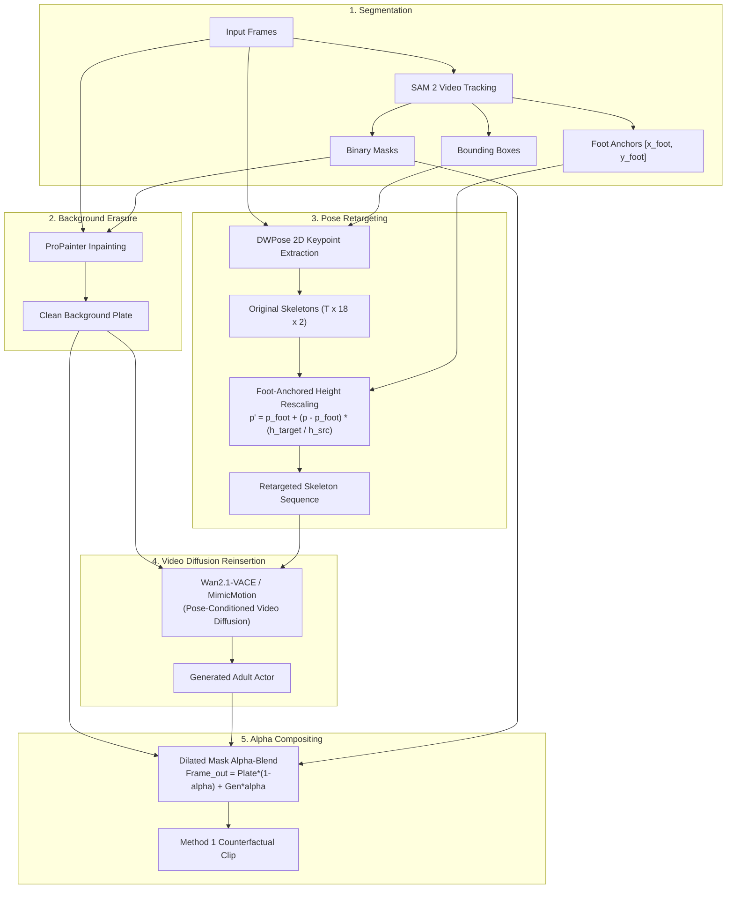
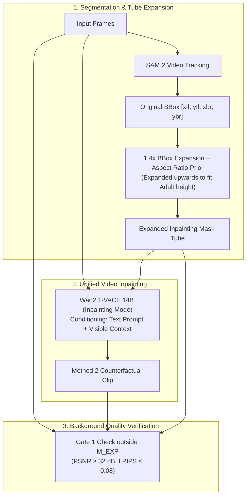

# DISCRETIO: Object Replacement & Counterfactual Generation Plan

This document details the scientific context, technical architecture, and validation protocol for the **Actor Identity Counterfactual Intervention** (Child $\leftrightarrow$ Adult Swap) within the DISCRETIO benchmark (*What Do World Models Implicitly Learn? Revealing Latent Behavioral Priors Through Future Rollouts*).

---

## 1. Scientific Context & Objective

The **Behavioral Prior** family in DISCRETIO tests whether a predictive world model (e.g., V-JEPA 2, Cosmos) infers actor-specific intent, hesitation, and vulnerability from observed identity when kinematics are held constant.

```
       Original Observation: Child Pedestrian (O)
                |
                v  [Intervention: Swap Identity, Fix Trajectory & Scene]
       Counterfactual Probe: Adult Pedestrian (O')
                |
        +-------+-------+
        |               |
        v               v
   World Model     World Model
   Rollouts R      Rollouts R'
        \               /
         v             v
       Rollout Divergence D(R, R')
       (Goal, Timing, Uncertainty Shifts)
```

To prevent world models from reacting to spurious low-level distribution shifts, the counterfactual must satisfy strict **Factor Isolation**:
1. **Scene Invariance**: The background, lighting, road surface, and surrounding agents must remain identical.
2. **Kinematic & Trajectory Invariance**: The pedestrian's ground position $[x_{\text{foot}}, y_{\text{foot}}]$, heading, and velocity must match across all frames $t \in [-T, 0]$.
3. **Actor Identity Shift**: Only the pedestrian's physical proportions, age cues, clothing, and gait should reflect the target age bracket.

---

## 2. Method 1: Erase + Retargeted Pose Insertion (Foot-Anchored)

Method 1 decouples the task into background erasure, kinematic retargeting, and conditioned video reinsertion.

### Architecture Pipeline



### Detailed Steps

1. **Pedestrian Segmentation (SAM 2)**:
   - SAM 2 tracks the pedestrian from prompt frame $t_0$, generating pixel-accurate binary masks $M_t$, tight bounding boxes $[x_{\text{tl}}, y_{\text{tl}}, x_{\text{br}}, y_{\text{br}}]$, and ground-contact foot anchors:
     $$x_{\text{foot}} = \frac{x_{\text{tl}} + x_{\text{br}}}{2}, \quad y_{\text{foot}} = y_{\text{br}}$$
2. **Background Erasure (ProPainter)**:
   - ProPainter inpaints the region covered by $M_t$ using temporal flow completion, removing the original child and outputting an uninterrupted background plate.
3. **2D Pose Extraction & Height Rescaling**:
   - DWPose extracts 18 COCO keypoints per frame.
   - Keypoints are rescaled about the foot anchor using demographic height ratios ($h_{\text{child}} \approx 0.60 \times h_{\text{adult}}$):
     $$\mathbf{p}'_{k, t} = \mathbf{p}_{\text{foot}, t} + (\mathbf{p}_{k, t} - \mathbf{p}_{\text{foot}, t}) \cdot \frac{h_{\text{target}}}{h_{\text{source}}}$$
   - This guarantees the adult’s feet contact the asphalt at the exact coordinates of the child, eliminating floating or sinking artifacts.
4. **Pose-Conditioned Video Diffusion (Wan2.1-VACE / MimicMotion)**:
   - The rescaled skeleton sequence drives video diffusion, conditioned on text prompts specifying the target age (e.g., *"an adult pedestrian walking along a road"*).
5. **Alpha Compositing**:
   - The generated actor is composited onto the clean background plate using the dilated segmentation mask to eliminate edge bleeding.

### Profile
- **Factor Isolation**: **High** (ground contact and heading are mathematically anchored).
- **Realism & Lighting**: High (diffusion model adapts lighting, but seam blending required).
- **Compute / Engineering**: Medium–High (chains 4 separate models: SAM 2, ProPainter, DWPose, Wan2.1-VACE).
- **Primary Failure Modes**: Edge seams at composite boundaries, unnatural body deformation if DWPose drops keypoints during severe occlusion.

---

## 3. Method 2: Unified Mask-Box Inpainting (Context-Aware)

Method 2 circumvents multi-model chaining by leveraging modern video inpainting models to jointly erase and redraw the target within an expanded spatio-temporal tube.

### Architecture Pipeline



### Detailed Steps

1. **Bounding Box Expansion with Aspect Ratio Priors**:
   - The original child bounding box is expanded by a scale factor (typically $1.4\times$) anchored at the bottom-center foot coordinate:
     $$\Delta h = h_{\text{orig}} \cdot (\text{scale} - 1.0), \quad y'_{\text{tl}} = \max(0, y_{\text{tl}} - \Delta h), \quad y'_{\text{br}} = y_{\text{br}}$$
     $$w' = h' \cdot \text{aspect\_ratio}_{\text{adult}}, \quad x'_{\text{tl}} = x_{\text{foot}} - \frac{w'}{2}, \quad x'_{\text{br}} = x_{\text{foot}} + \frac{w'}{2}$$
   - This provides sufficient spatial headroom for the larger adult body while keeping feet planted on the roadway.
2. **Unified Mask-Conditioned Video Inpainting (Wan2.1-VACE 14B)**:
   - The original video frames and binary expanded mask tube are fed directly into Wan2.1-VACE.
   - Text conditioning specifies the adult actor while negative prompts suppress distortion:
     - *Prompt*: `"an adult pedestrian, walking along a road, same pose and lighting, photorealistic"`
     - *Negative*: `"blurry, deformed, background distortion, extra limbs, duplicate person"`
   - The diffusion backbone observes the surrounding context (lighting, asphalt texture, moving vehicles) and inpaints the adult in a single pass.
3. **Background Preservation Verification**:
   - Pixels outside the expanded bounding box are verified against the original video to guarantee background integrity.

### Profile
- **Factor Isolation**: **Medium–High** (relies on model context inference to retain heading/gait; no explicit skeleton constraint).
- **Realism & Lighting**: **Very High** (flawless environmental lighting, cast shadows, and reflections).
- **Compute / Engineering**: **Low** (chains only SAM 2 and Wan2.1-VACE).
- **Primary Failure Modes**: Background bleeding if bounding box expands over street furniture or passing vehicles; subtle drift in pedestrian heading.

---

## 4. Side-by-Side Comparison Matrix

| Property | Method 1: Erase + Pose Retarget | Method 2: Unified Mask-Box Inpaint |
|---|---|---|
| **Pipeline Stack** | SAM 2 $\to$ ProPainter $\to$ DWPose $\to$ Wan2.1-VACE | SAM 2 $\to$ Expanded BBox $\to$ Wan2.1-VACE 14B |
| **Factor Isolation** | **High (2D foot-anchored)** | **Medium–High (context-guided)** |
| **Visual Realism** | High | **Very High** |
| **Shadow & Light Blending** | Requires compositing heuristics | Naturally resolved by diffusion backbone |
| **Compute Overhead** | High (4 inferences per clip) | Moderate (2 inferences per clip) |
| **Susceptibility to OOM** | High (ProPainter optical flow requires VRAM management) | Moderate (single diffusion pass) |
| **Role in Paper** | **Primary Method** (cleanest scientific isolation) | **Ablation & Speed Comparison** |

---

## 5. Empirical Selection & Quality Control Protocol (Table 6)

To rigorously select between Method 1 and Method 2—and validate the counterfactuals for publication—the following three-stage protocol is enforced:

### Stage 1: The Self-Replacement Sanity Check (Artifact Isolation Test)
- **Procedure**: Take an **adult** pedestrian clip $O_{\text{real}}$, run the pipeline to re-insert an **adult** ($O_{\text{recon}}$), and pass both to the target world model $M$.
- **Success Criterion**:
  $$D(M(O_{\text{real}}), M(O_{\text{recon}})) \approx 0 \ll D(M(O_{\text{child}}), M(O_{\text{adult\_swap}}))$$
- **Purpose**: Proves to reviewers that rollout divergences in the child $\to$ adult experiment are driven by **actor identity**, not diffusion inpainting artifacts.

### Stage 2: Automated Perceptual & Kinematic Quality Gates
All generated clips must pass three automated screening thresholds:
1. **Gate 1 — Background Preservation**:
   $$\text{PSNR} \ge 32.0\text{ dB} \quad \text{AND} \quad \text{LPIPS} \le 0.08$$
   Computed strictly on pixels outside the union of the original and edited masks.
2. **Gate 2 — Foot-Contact Consistency**:
   $$\text{RMS}_{\text{foot}} = \sqrt{\frac{1}{T} \sum_{t=1}^T \|\mathbf{p}_{\text{foot}, t}^{\text{edited}} - \mathbf{p}_{\text{foot}, t}^{\text{orig}}\|^2} \le 8.0\text{ px}$$
   Ensures the replacement pedestrian maintains the ground contact trajectory.
3. **Gate 3 — Target Age Classification Confidence**:
   $$\text{Confidence}_{\text{target\_age}} \ge 85\%$$
   Evaluated on cropped pedestrian sequences using MiVOLO / zero-shot CLIP.

### Stage 3: Blinded Human Validation Study (Paper Table 6)
- **Protocol**: 3–5 annotators blindly evaluate randomized, anonymized clip pairs across three dimensions on a 1–5 Likert scale:
  1. *Realism & Naturalness*
  2. *Factor Isolation (Pose & Trajectory Faithfulness)*
  3. *Absence of Visual Artifacts / Seams*
- **Agreement**: Inter-annotator reliability is quantified using Fleiss' Kappa:
  $$\kappa \ge 0.60 \quad (\text{Substantial Agreement})$$
- The winning method is formally reported in Table 6 as the benchmark generator.

---

## 6. Implementation Map in Repository

| Pipeline Stage | Script | Inputs | Outputs |
|---|---|---|---|
| **Step 0: Clip Selection** | `counterfactual_pipeline/00_select_clips.py` | `idd_ped_master_manifest.csv` | `selected_clips.json`, `selected_clips.csv` |
| **Step 1: Segmentation** | `counterfactual_pipeline/01_segment_pedestrian.py` | Video clips, `selected_clips.json` | `masks/frame_*.png`, `bboxes.json`, `foot_anchors.json` |
| **Step 2: Erasure** | `counterfactual_pipeline/02_erase_pedestrian.py` | Original frames, SAM 2 masks | `erased_frames/frame_*.png`, `erase_quality.json` |
| **Step 3a: Method 1** | `counterfactual_pipeline/03a_pose_retarget.py` | Erased plate, DWPose keypoints, masks | `method1/frames/frame_*.png`, `metadata.json` |
| **Step 3b: Method 2** | `counterfactual_pipeline/03b_unified_inpaint.py` | Original frames, expanded BBox masks | `method2/frames/frame_*.png`, `metadata.json` |
| **Step 4: Sanity Check** | `counterfactual_pipeline/04_sanity_self_replace.py` | Adult clips, reconstructed plates | `sanity_check_results.json`, report |
| **Step 5: Quality Gates** | `counterfactual_pipeline/05_metrics_auto.py` | Original & edited frames, masks | `metrics_report.csv`, `method_comparison.txt` |
| **Step 6: Human Study** | `counterfactual_pipeline/06_human_validation.py` | Generated video sets | Rating sheets, Fleiss' $\kappa$, Table 6 data |
| **Visual Inspection** | `counterfactual_pipeline/visualize_comparison.py` | All pipeline intermediate assets | 5-panel side-by-side MP4, GIF, PNG sheets |
